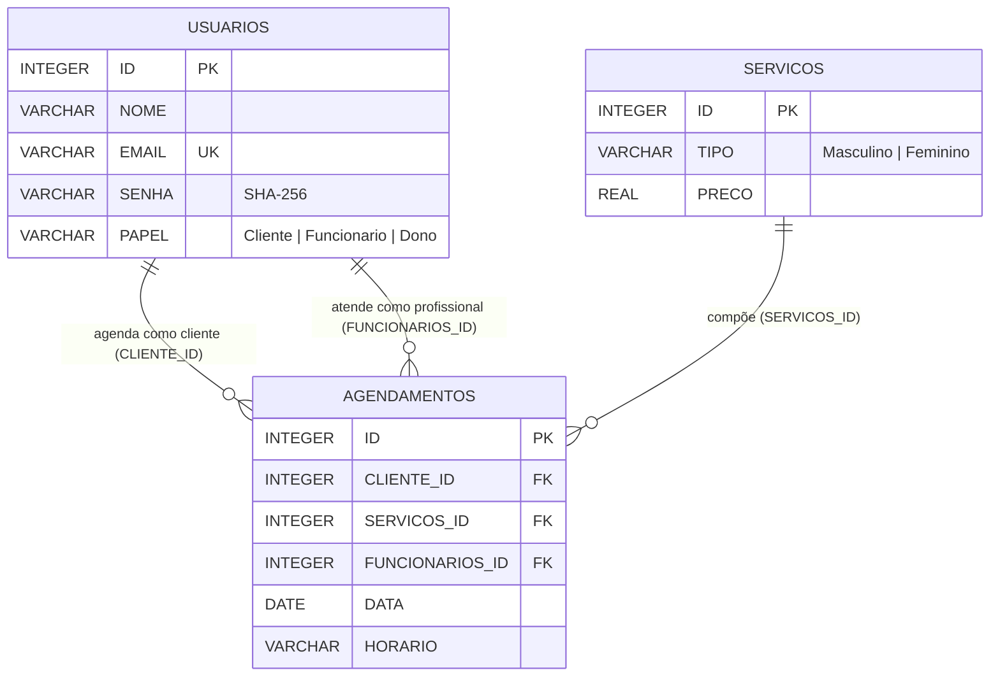

<div align="center">

# 💈 Sistema Barbearia

**Sistema completo de agendamento e gestão para barbearia em Python + SQLite**

[](https://www.python.org/)
[](https://www.sqlite.org/)
[](https://docs.python.org/3/library/tkinter.html)
[](#%EF%B8%8F-tecnologias-utilizadas)

*Projeto acadêmico desenvolvido para a disciplina de **Programação 2**, ministrada pelo Prof. **Adilson**.*

[Sobre](#-sobre-o-projeto) •
[Funcionalidades](#-funcionalidades) •
[Banco de Dados](#%EF%B8%8F-modelagem-do-banco-de-dados) •
[Como Executar](#-como-executar) •
[Logins de Teste](#-logins-de-teste-mockados) •
[Autores](#-autores)

</div>

---

## 📌 Sobre o Projeto

O **Sistema Barbearia** foi desenvolvido com foco em **simplicidade, clareza e organização modular**, utilizando exclusivamente bibliotecas nativas do Python — sem necessidade de instalar pacotes externos.

O sistema oferece duas formas de uso integradas ao mesmo banco de dados (`barbearia.db`):
- **Interface Gráfica (`interface.py`)** construída com `Tkinter`, intuitiva e pronta para uso;
- **Interface em Terminal (`main.py`)**, leve e direta via linha de comando.

---

## ✨ Funcionalidades

O acesso ao sistema é dividido por níveis de permissão (`Cliente`, `Funcionario` e `Dono`), direcionando cada usuário automaticamente para o seu painel após o login.

<details open>
<summary><b>🔓 Acesso Geral (Tela Inicial)</b></summary>

- **Fazer Login:** Autentica usuário por e-mail e senha (hash `SHA-256`) e redireciona para o painel correspondente ao seu papel.
- **Cadastrar-se:** Permite que novos usuários criem uma conta exclusivamente com o perfil `Cliente`.
- **Recuperar Senha:** Gera um código de verificação aleatório de 6 dígitos, envia para o e-mail cadastrado via `smtplib` (Gmail SMTP) e permite redefinir a senha.

</details>

<details>
<summary><b>✂️ Área do Cliente</b></summary>

- **Agendar Corte em Tempo Real:**
  - Seleção do profissional cadastrado (`Funcionario`);
  - Consulta dos próximos 6 dias de funcionamento (segunda a sábado);
  - Filtragem dinâmica de horários livres (`09:00` às `17:00`, exceto `12:00`), ocultando horários já ocupados na agenda do profissional;
  - Escolha do serviço (`Masculino — R$ 40,00` ou `Feminino — R$ 80,00`) e confirmação imediata no banco.

</details>

<details>
<summary><b>💈 Área do Funcionário (Barbeiro / Cabeleireira)</b></summary>

- **Visualizar Agenda:** Lista todos os atendimentos marcados para o profissional logado em **ordem cronológica** (`DATA` e `HORARIO`), exibindo data, horário, nome do cliente e tipo de serviço.

</details>

<details>
<summary><b>📊 Área do Dono (Administrador)</b></summary>

- **Relatório Financeiro:** Exibe a quantidade total de cortes realizados e o faturamento gerado individualmente por cada profissional, além do **lucro total da barbearia**.
- **Cadastrar Equipe:** Permite registrar novos usuários com privilégios elevados (`Funcionario` ou outro `Dono`).

</details>

---

## 🛠️ Tecnologias Utilizadas

| Tecnologia | Finalidade |
| :--- | :--- |
| **Python 3** | Linguagem principal do projeto |
| **`sqlite3`** | Persistência local e consultas SQL relacionais (`barbearia.db`) |
| **`hashlib` (`sha256`)** | Criptografia irreversível das senhas armazenadas |
| **`smtplib` + `email.message`** | Envio real de e-mail para recuperação de senha |
| **`tkinter` + `ttk`** | Interface gráfica simples e executável |
| **`datetime`** | Cálculo dos dias úteis disponíveis para agendamento |

---

## 📂 Estrutura do Repositório

```text
Sistema_Barbearia/
├── interface.py      # Aplicação com interface gráfica (Tkinter)
├── main.py           # Aplicação em modo terminal (CLI)
├── db.py             # Conexão SQLite, criação das tabelas e dados iniciais
├── login.py          # Autenticação, cadastro de clientes e envio de código por e-mail
├── cliente.py        # Regras de dias/horários disponíveis e agendamento do cliente
├── funcionario.py    # Consulta cronológica da agenda do profissional
├── dono.py           # Relatório financeiro e cadastro de equipe
├── usuarios.sql      # Script SQL da tabela USUARIOS + equipe inicial
├── servicos.sql      # Script SQL da tabela SERVICOS + valores padrão
├── agendamentos.sql  # Script SQL da tabela AGENDAMENTOS e chaves estrangeiras
├── barbearia.db      # Banco de dados SQLite pronto para uso
└── INSTRUCOES.txt    # Instruções de instalação e uso para entrega acadêmica
```

---

## 🗄️ Modelagem do Banco de Dados

O banco possui integridade referencial ativada (`PRAGMA foreign_keys = ON`) com três tabelas principais:



---

## 🚀 Como Executar

### 1. Clonar o repositório
```bash
git clone https://github.com/iagosm-oliveira/Sistema_Barbearia.git
cd Sistema_Barbearia
```

### 2. Executar o programa
Como o projeto utiliza apenas módulos nativos do Python, basta rodar diretamente:

```bash
# Modo Interface Gráfica (recomendado)
python interface.py
```

Ou, caso prefira utilizar no terminal:

```bash
# Modo Terminal (CLI)
python main.py
```

<details>
<summary><b>📦 Opcional: Gerar executável (.exe) para Windows</b></summary>

Caso deseje empacotar a interface em um único arquivo `.exe` que abre sem janela de terminal:

```bash
pip install pyinstaller
pyinstaller --onefile --noconsole interface.py
```

O executável será gerado na pasta `dist/`.

</details>

---

## 🔑 Logins de Teste (Mockados)

O banco já vem pré-populado com um administrador e quatro profissionais (dois barbeiros e duas cabeleireiras) para facilitar os testes de cada painel.

> **Senha padrão para todas as contas abaixo:** `123`

| Perfil | Nome | E-mail | Senha |
| :--- | :--- | :--- | :--- |
| 👑 **Dono** | Carlos Dono | `dono@barbearia.com` | `123` |
| 💈 **Funcionário** | João Barbeiro | `joao@barbearia.com` | `123` |
| 💈 **Funcionário** | Pedro Barbeiro | `pedro@barbearia.com` | `123` |
| 💇‍♀️ **Funcionária** | Maria Cabeleireira | `maria@barbearia.com` | `123` |
| 💇‍♀️ **Funcionária** | Ana Cabeleireira | `ana@barbearia.com` | `123` |

> 💡 **Dica:** Para testar o envio real do código de recuperação de senha, crie uma conta pela opção **"Cadastrar-se"** utilizando um e-mail pessoal válido e utilize a função **"Recuperar Senha"** na tela inicial.

---

## 🤝 Autores

Projeto desenvolvido em dupla para a disciplina **Programação 2** (Prof. Adilson):

- **Iago Oliveira** — [@iagosm-oliveira](https://github.com/iagosm-oliveira)
- **Matheus Soares**